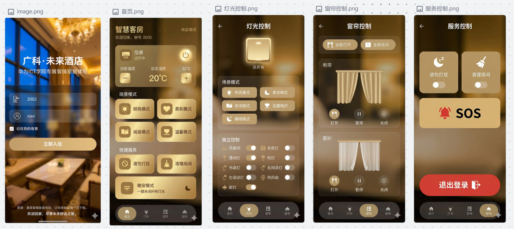

# Smart Guest Room 智慧客房管控系统
## 项目界面预览

## 项目简介
面向酒店、民宿智慧化场景，基于HarmonyOS ArkTS开发的客房智能管控移动端系统。
系统提供客房设备一站式控制能力，包含空调、灯光、窗帘、客房服务等功能，内置多种场景模式，支持多端协同访问。
系统打通前端交互、后端接口、数据存储完整链路，解决传统酒店客房设备管控零散、人工运维成本高、服务响应滞后的痛点。
预留数据接口，可拓展接入大模型，实现能耗预测、设备故障异常识别、客房智能问答等AI场景。

## 项目界面预览
本项目移动端包含登录页、首页总控、灯光控制、窗帘控制、客房服务五大页面：
1. **登录入住页**：房号登录，身份校验，快速进入客房控制系统
2. **首页总控页**：空调温度调节，多种场景模式切换（明亮/柔和/阅读/温馨/晚安一键全关），快捷客房服务入口
3. **灯光控制页**：总开关+多子灯独立控制，5种灯光场景模式自由切换
4. **窗帘控制页**：布帘、窗纱分开控制，支持一键全开/全关、暂停
5. **服务控制页**：请勿打扰、清理房间、SOS紧急求助，账号退出登录

## 技术栈
ArkTS / HarmonyOS / Stage模型 / SpringBoot / MySQL / uCharts数据可视化

## 功能模块
- 客房空调：温度调节、设备启停，实时显示运行状态
- 灯光管理：总控开关 + 多灯具独立控制，多场景灯光预设
- 窗帘管理：布帘、窗纱独立控制，支持启停与暂停
- 客房服务：请勿打扰、清理房间、SOS紧急告警
- 场景模式：明亮、柔和、阅读、温馨、晚安一键关灯
- 多端协同：手机、平板等鸿蒙设备多端联动

## AI拓展方向
1. 基于历史数据做客房能耗预测，统计空调、灯光用电量
2. 设备运行异常自动识别告警，故障上报后台
3. 接入大模型实现客房智能客服问答，语音控制客房设备
